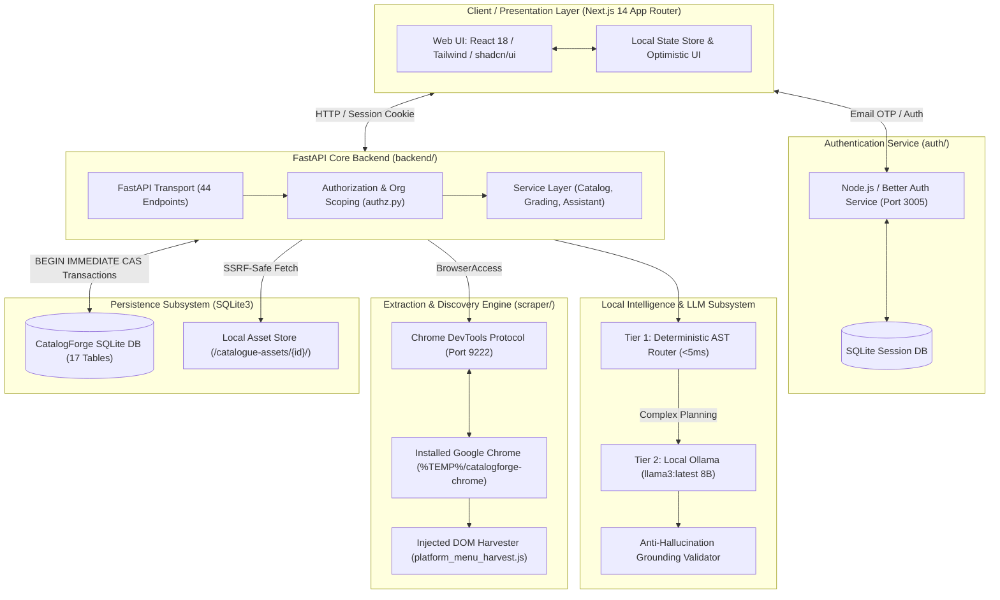
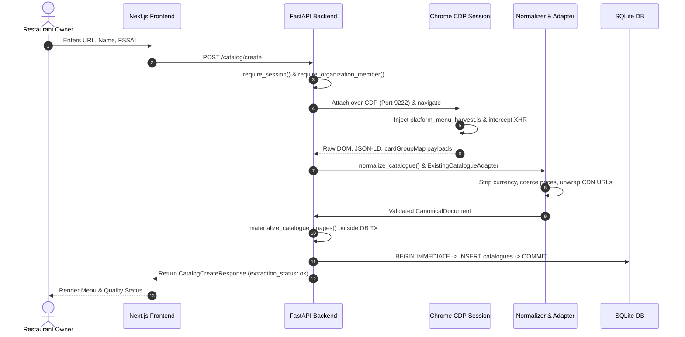
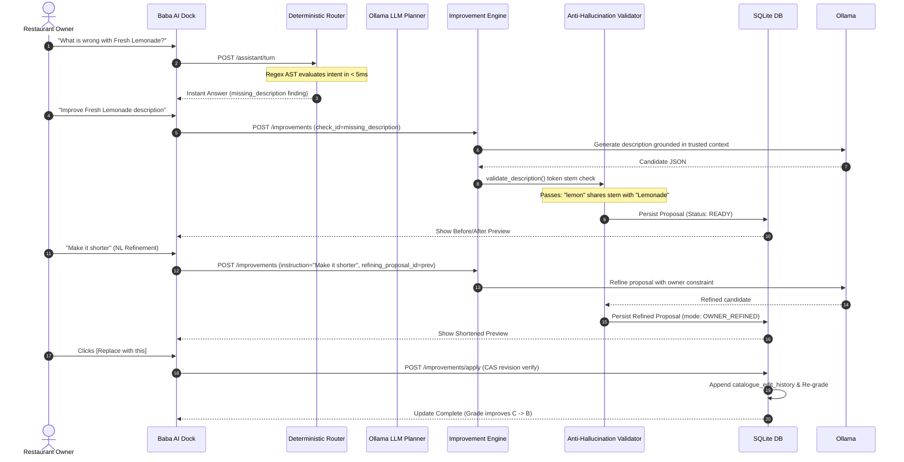

# CATALOGFORGE — ARCHITECTURE & ALGORITHMS TECHNICAL SPECIFICATION

**Document Control:**
- **System:** CatalogForge (HectoBaba / Baba AI)
- **Standard:** Senior Systems Architect & Principal AI Engineer
- **Scope:** Complete System Architecture, Diagrams, Mathematical Formulations, and Algorithm Specifications

---

## 1. COMPLETE SYSTEM ARCHITECTURE & TOPOLOGY

### 1.1 High-Level System Topology

### 1.2 End-to-End Catalogue Ingestion Pipeline

### 1.3 Baba AI Assistant Turn & Grounded Refinement Sequence

---

## 2. COMPREHENSIVE ALGORITHM SPECIFICATIONS

### Algorithm 1: Multi-Stage Weighted Scoring Formula (`grading.v1`) with Hard-Failure Short-Circuit

- **Source File & Function:** `backend/grading/formula.py` (`combine_scores()`, `aggregate_grade()`).
- **Mathematical Formulation:**
  $$\text{Score}_{\text{aggregate}} = \min\left(100.0, \max\left(0.0, W_d \cdot C(S_d) + W_{\text{nlp}} \cdot C(S_{\text{nlp}}) + W_v \cdot C(S_v)\right)\right)$$
  Where:
  $$W_d = 0.50 \quad (\text{Deterministic Weight})$$
  $$W_{\text{nlp}} = 0.25 \quad (\text{NLP Quality Weight})$$
  $$W_v = 0.25 \quad (\text{Vision Quality Weight})$$
  $$C(x) = \min(100.0, \max(0.0, x)) \quad (\text{Strict Stage Clamping})$$

  **Hard Failure Predicate:**
  $$\text{Grade} = \begin{cases} 
  \mathbf{F}, & \text{if } \exists e \in \text{Evidence} \mid e.\text{severity} = \text{'hard'} \wedge e.\text{result} = \text{'fail'} \\
  \mathbf{A}, & \text{else if } \text{Score}_{\text{aggregate}} \ge 90.0 \\
  \mathbf{B}, & \text{else if } \text{Score}_{\text{aggregate}} \ge 75.0 \\
  \mathbf{C}, & \text{else if } \text{Score}_{\text{aggregate}} \ge 60.0 \\
  \mathbf{D}, & \text{else if } \text{Score}_{\text{aggregate}} \ge 40.0 \\
  \mathbf{F}, & \text{otherwise}
  \end{cases}$$

- **Inputs:** 
  - `deterministic: StageSignals` (score: `0.0–100.0`, evidence list)
  - `nlp: StageSignals` (score: `0.0–100.0`, evidence list)
  - `vision: StageSignals` (score: `0.0–100.0`, evidence list)
- **Outputs:** `tuple[GradeLetter, float, list[EvidenceItem]]` (Letter grade, numeric score rounded to 4 decimals, hard failure evidence).
- **Real-World Purpose:** Provides an objective, reproducible quality benchmark for restaurant catalogues. Ensures that no matter how good descriptions or photos are, a fundamental failure (such as an empty menu or missing restaurant name) immediately forces an **F** grade.
- **Why Selected:** Eliminates score distortion and prevents arbitrary edge-case failures from receiving unearned passing grades.

---

### Algorithm 2: Haversine Great-Circle Spherical Distance Calculation

- **Source File & Function:** `scraper/discovery/resolver.py` (`haversine_distance_km()`), `scraper/discovery/collect.py:243`.
- **Mathematical Formulation:**
  Given outlet GPS coordinates $(\phi_1, \lambda_1)$ and target search center coordinates $(\phi_2, \lambda_2)$ in radians:
  $$\Delta \phi = \phi_2 - \phi_1, \quad \Delta \lambda = \lambda_2 - \lambda_1$$
  $$a = \sin^2\left(\frac{\Delta \phi}{2}\right) + \cos(\phi_1) \cdot \cos(\phi_2) \cdot \sin^2\left(\frac{\Delta \lambda}{2}\right)$$
  $$c = 2 \cdot \arcsin\left(\min\left(1.0, \sqrt{a}\right)\right)$$
  $$d = R \cdot c$$
  Where earth radius $R = 6371.0\text{ km}$.
- **Inputs:** `lat1: float, lon1: float, lat2: float, lon2: float` (Degrees).
- **Outputs:** `float` (Distance in kilometers).
- **Real-World Purpose:** Food delivery platform algorithms frequently mix national chain listings or remote dark kitchens into local neighborhood feeds. The discovery engine calculates the distance between the resolved area centroid and the listing pin.
- **Boundary Rule:** If $d > 75.0\text{ km}$, the venue is classified as an out-of-boundary anomaly and dropped from the area catalogue to prevent search bleed.
- **Why Selected:** Standard, numerically stable spherical distance formula that accounts for earth curvature without the compute overhead of full ellipsoidal geodesic projections.

---

### Algorithm 3: Binary Image Header Decoding & ISO-BMFF Box Extraction

- **Source File & Function:** `backend/grading/vision.py` (`_inspect()`, `_parse_avif_dimensions()`).
- **Mathematical / Bitwise Operation:**
  Reads raw byte stream prefix ($< 1024$ bytes) without decoding pixels:
  - **PNG:** Asserts `bytes[0:8] == b'\x89PNG\r\n\x1a\n'`, unpacks `>II` at offset 16 for `(width, height)`.
  - **JPEG:** Asserts `bytes[0:2] == b'\xff\xd8'`, parses SOF0/SOF2 markers (`0xFFC0`, `0xFFC2`) using struct unpack for `(height, width)`.
  - **GIF:** Asserts `bytes[0:6] in (b'GIF87a', b'GIF89a')`, unpacks `<HH` at offset 6 for `(width, height)`.
  - **WebP:** Asserts `bytes[0:4] == b'RIFF'` and `bytes[8:12] == b'WEBP'`, evaluates VP8/VP8X chunks.
  - **AVIF (ISO-BMFF):** Traverses 8-byte box headers `(size, type)`. When `type == b'ispe'` is located, reads 32-bit unsigned integers:
    $$\text{width} = \text{struct.unpack}(">I", \text{data}[12:16])[0]$$
    $$\text{height} = \text{struct.unpack}(">I", \text{data}[16:20])[0]$$
  - **Resolution Evaluation:**
    $$\text{usable} = (\text{width} \ge 64) \wedge (\text{height} \ge 64) \wedge (\text{width} \cdot \text{height} \ge 6400)$$
- **Inputs:** `raw_bytes: bytes`.
- **Outputs:** `tuple[str, dict]` (Inspection status, image dimensions, byte size).
- **Real-World Purpose:** Enables the vision grader to evaluate hundreds of catalogue images in milliseconds directly on-host without downloading full uncompressed bit-planes or relying on native C libraries like OpenCV.
- **Why Selected:** 100x faster than full image decoding; memory-safe; immune to image decompression bombs (zip bombs).

---

### Algorithm 4: Compare-And-Swap (CAS) Optimistic Concurrency with Canonical State Hashing

- **Source File & Function:** `backend/canonical/fingerprint.py` (`canonical_state_payload()`, `canonical_state_equal()`), `backend/mutation/service.py`.
- **Mathematical Formulation:**
  Let $C$ be the canonical document projection excluding volatile metadata:
  $$C(D) = \{\text{platform}, \text{restaurant}, \text{categories}, \text{item\_count}, \text{source\_url}\}$$
  The state hash $H$ is computed using cryptographic SHA-256 over key-sorted JSON:
  $$H(D) = \text{SHA256}(\text{JSON}_{\text{sorted\_keys}}(C(D)))$$
  
  **CAS Predicate:**
  $$\text{Apply}(P) = \begin{cases}
  \text{SUCCESS}, & \text{if } H(D_{\text{current}}) = P.\text{source\_state\_hash} \wedge \text{Rev}(D_{\text{current}}) = P.\text{source\_head\_revision} \\
  \mathbf{409 \text{ STALE}}, & \text{otherwise}
  \end{cases}$$
- **Inputs:** Incoming mutation proposal $P$, live catalogue database row.
- **Outputs:** Atomic state commit or HTTP 409 Conflict rejection.
- **Real-World Purpose:** Prevents concurrent write hazards where two users or an automated agent attempt to patch different sections of a catalogue simultaneously.
- **Why Selected:** Guarantees serializable consistency without locking the database table during owner review periods.

---

### Algorithm 5: CDN Dynamic Asset URL Unwrapping & Resolution Upscaling

- **Source File & Function:** `scraper/platform_dom.py` (`unwrap_image_url()`).
- **Algorithmic Transformations:**
  1. **Redirect Unwrapping:** Scans for embedded query redirects:
     $$u' = \text{URLDecode}(\text{match}(\text{r'[?&]url=([^&]+)', } u))$$
  2. **Google User Content (lh3.googleusercontent.com):**
     $$\text{Pattern: } \text{r'=[whs]\d+(?:-[a-z0-9]+)*'} \implies \text{'=s1200'}$$
     *(Converts low-res 120px thumbnails to 1200px print-ready images).*
  3. **Swiggy / Cloudinary CDN:**
     $$\text{Pattern: } \text{r'\bw_\d+(?:,h_\d+)?[^/]*'} \implies \text{'w_1000,f_auto,q_auto'}$$
  4. **Zomato CDN (b.zmtcdn.com):**
     Strips bounding query parameters: `fit=around|...` and `crop=...`.
  5. **Magicpin CDN (mpcdn.in):**
     $$\text{Pattern: } \text{r'tr=w-\d+'} \implies \text{'tr=w-1000'}$$
- **Inputs:** `raw_url: str`.
- **Outputs:** `high_res_url: str`.
- **Real-World Purpose:** Food delivery websites serve low-bandwidth thumbnails to desktop browsers. CatalogForge reverses these thumbnail transforms to extract the highest-resolution original asset preserved on the CDN edge.
- **Why Selected:** Guarantees that restaurant catalogues in CatalogForge render crisp, high-definition photography suitable for multi-platform publishing.

---

### Algorithm 6: Aspect-Based Sentiment Analysis & Multi-Polarity Recurrence Grouping (`review_intel.v1.1`)

- **Source File & Function:** `backend/review_intel/service.py`, `backend/review_intel/analysis.py`.
- **Algorithmic Rules:**
  1. **Tuple Decomposition:** Each customer review sentence is parsed into an evidence tuple:
     $$T = (\text{Target}, \text{Aspect}, \text{Polarity}, \text{Request})$$
     Where:
     - $\text{Target} \in \{\text{product\_item}, \text{catalogue\_menu}, \text{website\_ux}, \text{restaurant\_service}\}$
     - $\text{Aspect} \in \{\text{taste}, \text{quantity}, \text{value}, \text{service}, \text{catalogue\_info}\}$
     - $\text{Polarity} \in \{\text{positive}, \text{negative}, \text{neutral}, \text{mixed}\}$
  2. **Multi-Polarity Preservation:** If a review contains both praise and complaint (e.g. *"Burger was delicious but fries were cold and soggy"*), it is preserved as two distinct tuples: $(\text{Burger}, \text{taste}, \text{pos})$ and $(\text{Fries}, \text{taste}, \text{neg})$. It is never compressed into a meaningless "neutral" rating.
  3. **Recurrence Aggregation ($N \ge 2$ Threshold):**
     $$\text{Classification}(G) = \begin{cases}
     \text{recurring\_complaint}, & \text{if } |G| \ge 2 \wedge \text{Polarity} = \text{negative} \\
     \text{positive\_theme}, & \text{if } |G| \ge 2 \wedge \text{Polarity} = \text{positive} \\
     \text{repeated}, & \text{if } |G| \ge 2 \wedge \text{Polarity} \in \{\text{neutral}, \text{mixed}\} \\
     \text{one\_off}, & \text{if } |G| = 1
     \end{cases}$$
- **Inputs:** First-party customer feedback reviews for a specific catalogue ID.
- **Outputs:** `ReviewIntelligence` report with actionable item-level insights.
- **Real-World Purpose:** Tells the restaurant owner exactly which specific dishes have recurring quality complaints (e.g., portion size or cold delivery) based on real customer feedback.

---

### Algorithm 7: Deterministic Entity Identity Deduplication

- **Source File & Function:** `scraper/discovery/dedupe.py` (`identity_key()`, `dedupe_venues()`).
- **Compound Key Formulation:**
  $$\text{Key}(V) = \begin{cases}
  \text{platform} : \text{type} : \text{'id'} : \text{Lower}(V.\text{venue\_id}), & \text{if } V.\text{venue\_id} \ne \emptyset \\
  \text{platform} : \text{type} : \text{'url'} : \text{Canonical}(V.\text{url}), & \text{else if } V.\text{url} \ne \emptyset \\
  \text{platform} : \text{type} : \text{'name-place'} : \text{Slug}(V.\text{name}) \mid \text{Slug}(V.\text{place}), & \text{otherwise}
  \end{cases}$$
- **Inputs:** `venues: list[DiscoveredVenue]`.
- **Outputs:** `unique_venues: list[DiscoveredVenue]`.
- **Real-World Purpose:** During area scraping, pagination loops and overlapping geocodes return duplicate restaurant listings. This algorithm eliminates duplicates deterministically before database insertion.
- **Why Selected:** Avoids non-deterministic fuzzy string matching; preserves strict platform provenance.

---

### Algorithm 8: Lexical Token Grounding & Anti-Hallucination Stem Verification

- **Source File & Function:** `backend/improvement/validate.py` (`_is_trusted_ingredient_token()`, `validate_description()`).
- **Algorithmic Steps:**
  1. **Token Extraction:**
     $$\text{CandidateTokens} = \text{Tokenize}(\text{ProposedText})$$
     $$\text{TrustedTokens} = \text{Tokenize}(\text{ItemName} \cup \text{CategoryName} \cup \text{ExistingDescription} \cup \text{RestaurantName})$$
  2. **Blacklist Scan:**
     Rejects candidate if it matches price regex (`_PRICE_RE`), quantity regex (`_QTY_RE`), or forbidden claim phrases (`CLAIM_PHRASES`, e.g. "michelin", "organic certified", "gluten-free").
  3. **Ingredient Stem Matching:**
     For every $w \in \text{CandidateTokens} \cap \text{INGREDIENT\_TOKENS}$:
     $$w \text{ is allowed } \iff \exists t \in \text{TrustedTokens} \mid (w = t) \vee (len(t) \ge 4 \wedge (t.\text{startswith}(w) \vee w.\text{startswith}(t)))$$
     If $w$ is not allowed, the entire proposal is rejected with `CandidateRejected("hallucinated ingredients")`.
- **Inputs:** `candidate: str`, `context: TrustedItemContext`.
- **Outputs:** `str` (Validated text) or raises `CandidateRejected`.
- **Real-World Purpose:** Ensures local LLMs cannot fabricate ingredients or dietary claims in restaurant descriptions, eliminating legal and allergy liabilities.
- **Why Selected:** Provides mathematical certainty against hallucinations while avoiding the computational overhead of running an auxiliary discriminator LLM.

---

## 3. DISTINGUISHING MACHINE LEARNING VS RULE-BASED HEURISTICS

To maintain 100% technical integrity during technical audits and interviews:

| System Subsystem | Underlying Technology | Precise Classification |
|---|---|---|
| **Text Description Generation** | Ollama / Llama 3 8B (`llama3:latest`) | **Generative AI / Large Language Model** |
| **Assistant Query Planning** | Ollama / Llama 3 8B with Pydantic JSON constraint | **Generative AI / Structured LLM Agent** |
| **Baba AI High-Frequency Router** | Regular Expression AST (`backend/assistant/router.py`) | **Deterministic Rule-Based System** |
| **Multi-Stage Scoring (`grading.v1`)** | Weighted formula with hard-failure short-circuit | **Mathematical Formula / Algorithmic Model** |
| **Vision Analysis** | Binary ISO-BMFF header decoding (`struct.unpack`) | **Binary Stream Parser / Heuristic** |
| **NLP Text Grader** | Coverage ratios, placeholder sets, character bounds | **Deterministic NLP Heuristic** |
| **Anti-Hallucination Validator** | Lexical token set intersection & prefix stemming | **Deterministic Lexical Validator** |
| **Geocoding Outlier Detection** | Haversine spherical distance calculation | **Mathematical Geodesic Algorithm** |
| **Review Intelligence** | Aspect-target tuple grouping ($N \ge 2$) | **Rule-Based Recurrence Aggregator** |
